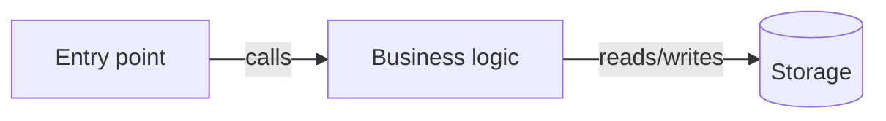

<!-- HOW the solution is built, in enough detail to implement without re-deciding. Must honor the
     project's hard rules (from its agent/contributor instructions and guidelines). Record heavy
     decisions inline (context, options, why). Delete sections that don't apply to this project
     instead of leaving them empty; add one if the project has a layer this template doesn't name. -->

# Design — {{TASK_TITLE}}

[⌂ index](index.md) · satisfies [requirements.md](requirements.md)

## Overview

<!-- The approach in a paragraph. What's the shape of the solution as a vertical slice? -->

## Key decisions

<!-- Any decision with real trade-offs: context/constraint, the choice (stated plainly: "We will …"),
     what was rejected and why, and whether it bends a project rule (if so, it's a blocking question). -->

## Layers & modules touched

<!-- Map the change across the project's REAL layers/modules, named as the codebase names them
     (e.g. UI / application logic / domain / data / infrastructure, or packages in a monorepo). -->

| Layer / module | What changes |
| --- | --- |
| | |

## Components & logic

<!-- The units that change or appear: components, services, handlers, jobs, functions. Where the
     business logic lives, per the project's architecture. Existing pieces reused rather than rebuilt. -->

## Data model & migrations

<!-- Entities, schemas, tables, stored formats affected. Every schema change goes through the
     project's migration mechanism. How existing data and older clients keep working. -->

## Interfaces & contracts

<!-- APIs, events, CLI flags, public types, config keys added or changed. Breaking or not. If the
     contract is generated code, name the source of truth and the regeneration command. -->

## UI & user-facing text

<!-- Screens/states touched, input and validation, empty/loading/error states, copy, styling via the
     project's design tokens, i18n — per the project's conventions. -->

## Integrations & configuration

<!-- External services, SDK wrappers, environment variables, feature flags. Behavior when an
     integration is unavailable. -->

## Error handling & edge cases

<!-- How failures surface and are logged, per the project's pattern. Empty states, boundary values,
     concurrency, partial failure, retries. -->

## Testing approach

<!-- What gets unit/integration/e2e coverage, per the project's testing rules. -->

## Diagram

