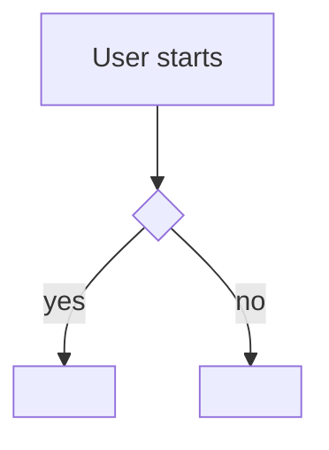
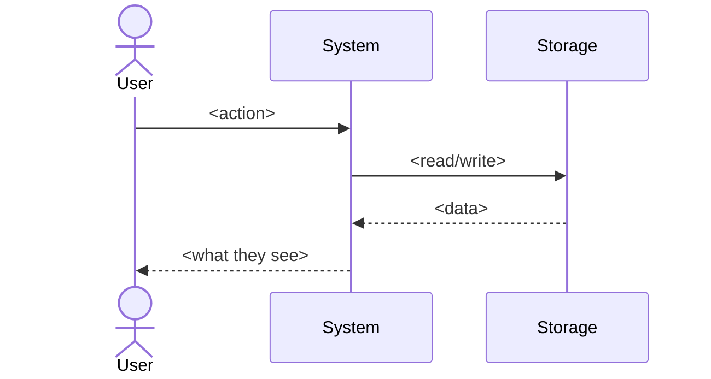

<!-- The task made concrete for a NON-technical reader: what the user does, sees, and gets.
     Plain language, Before/After, and Mermaid diagrams. If you can't tell this story simply,
     the requirements aren't clear yet — go back. When there is no end user (a library, an API,
     an internal job), the "user" is whoever calls it — tell the story from their side. -->

# Happy path — {{TASK_TITLE}}

[⌂ index](index.md)

## In one sentence

<!-- "A user who <situation> can now <do the thing> and sees <result>." -->

## Before / After

| | Before (today) | After (this task) |
| --- | --- | --- |
| What the user does | | |
| What the user sees | | |
| What they get | | |

## Example 1 — <short scenario name>

<!-- Walk one real user through it, step by step, in plain language. Name the screens, commands, or calls they use. -->

1. …
2. …
3. …

## Example 2 — <another scenario>

1. …

## User flow

## Before → After (sequence)

<!-- Keep diagrams small and honest. Prefer two clear diagrams over one sprawling one. -->
